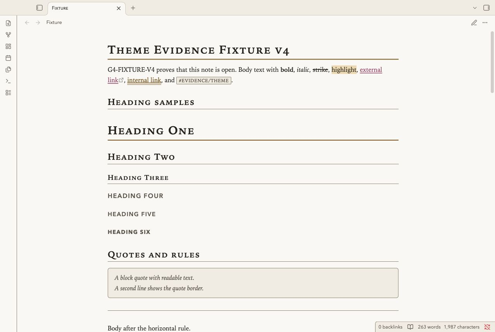
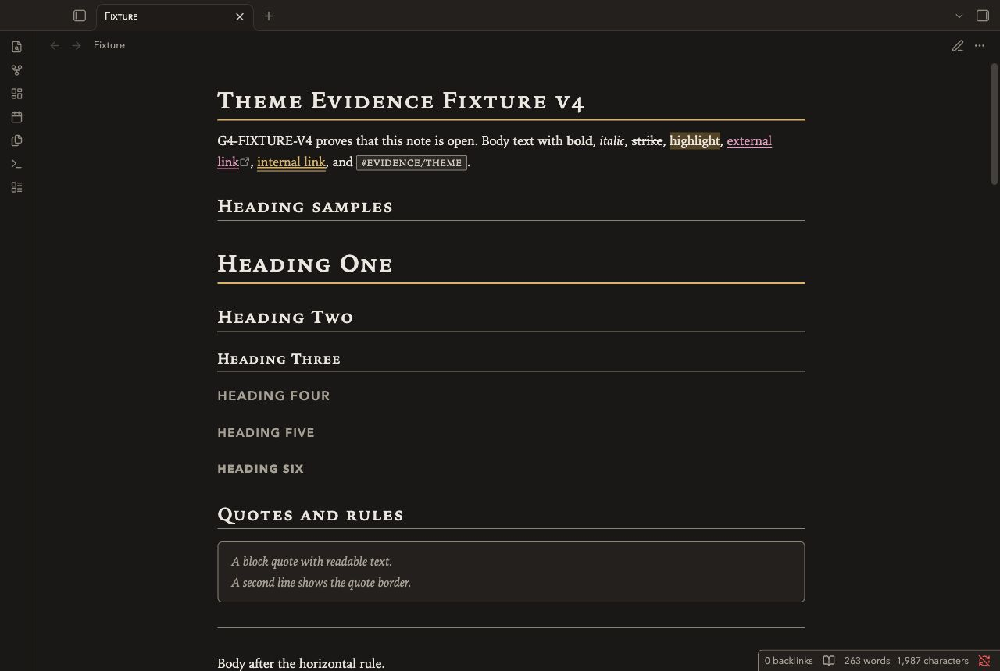
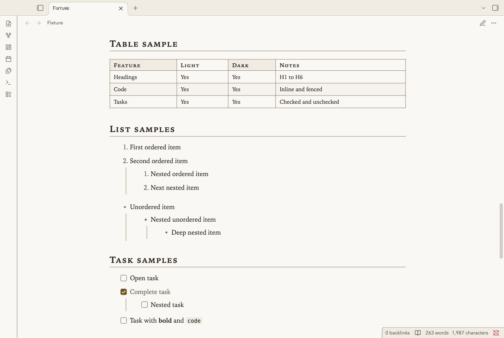
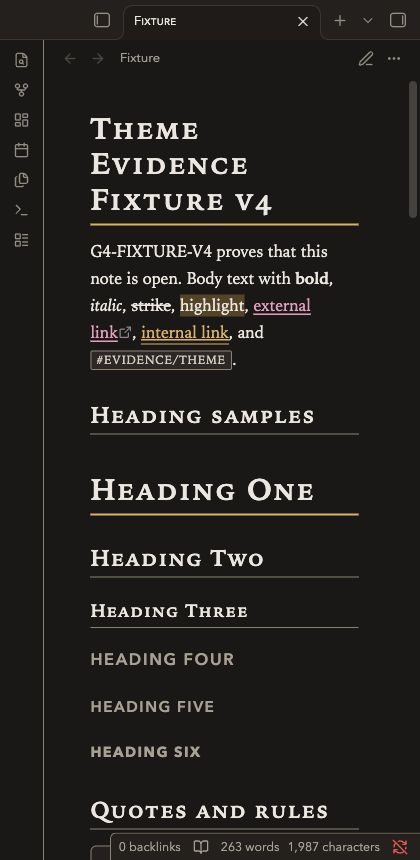

# Gallery Marginalia

Gallery Marginalia is for image collections, exhibition notes and visual research.
Warm paper and dark charcoal support serif text and gold rules.
Images have mat frames. Quotes and callouts use gallery labels.
Tables use catalogue rows. Small-cap headings separate the exhibits.

## Screenshots

These images show the desktop renderer with a test note.






## Install

1. Download `theme.css` and `manifest.json` from this repository.
2. Open your vault folder.
3. Create `.obsidian/themes/Gallery Marginalia/`.
4. Copy both files into that folder.
5. Open Settings in Obsidian.
6. Select Appearance.
7. Select Gallery Marginalia in the theme list.

Use the folder name `Gallery Marginalia`, as written in the manifest.
The repository name is not the installation folder name.

## Uninstall

1. Open Settings, then Appearance.
2. Select the default theme.
3. Remove `.obsidian/themes/Gallery Marginalia/` if you no longer need it.

Your notes remain in the vault.

## Compatibility

The minimum declared Obsidian version is 1.5.0.
The desktop renderer was tested with Obsidian 1.14.4.
Mobile was not tested. A narrow desktop capture does not test a mobile device.
The current revision needs independent review against the NoteMods 95-point gate.

## Customize

Put changes in a CSS snippet. Enable it in Settings, then Appearance.
The theme uses system fonts. It has no Style Settings panel.

```css
body.theme-light,
body.theme-dark {
  --file-line-width: 44rem;
  --font-text-theme: Georgia, serif;
  --gallery-mat: var(--background-secondary);
  --gallery-shadow: none;
}
```

`--gallery-rule` controls the gold rules.
`--h1-size` through `--h6-size` control heading sizes.
Check text and border contrast after you change colors.

## Known limits

- Image frames add space around images. Use a CSS snippet to remove their border for edge-to-edge diagrams.
- Small caps depend on the installed serif font. Georgia is a fallback.
- H4 through H6 use uppercase labels. Long headings can wrap on narrow panes.
- Wide tables and code blocks can need horizontal scrolling.
- Callout types share the gallery palette. Titles and icons identify the type. Warning and danger callouts also have distinct borders.
- Plugin views can use their own styles. They were not part of the fixture test.
- Automated contrast checks do not certify WCAG conformance. Screen reader use has not been tested.

## License

[MIT License](LICENSE). The original copyright notice is retained.
NoteMods maintains this theme.
